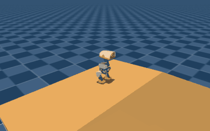
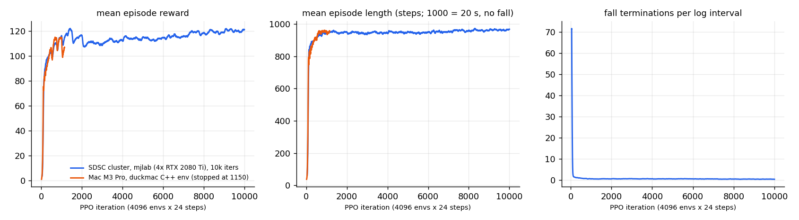

# microduck-walk

PPO velocity-tracking walking policies for Pollen Robotics' **microduck**, a 14-DoF, ~25 cm biped driven by Dynamixel XL330 servos. All training is in simulation, with domain randomization over servo and supply-voltage behavior.



*My walking policy (`policies/walk_flat_10k.onnx`, trained from scratch) climbs a 5° ramp and is pushed over by a scripted 8 N shove. Pollen's `alpha_stand` get-up policy stands it back up. My policy then walks down 1 cm steps it never saw in training. Source: `demo/play_terrain_loop.py`.*

This project reproduces Pollen's [`microduck_rl`](https://github.com/pollen-robotics/microduck_rl) velocity task. The robot model, reward terms and randomization ranges are theirs. My work:

1. **`duckmac/`: a from-scratch re-implementation of their training environment for Apple Silicon.** The upstream stack (mjlab + MuJoCo Warp) wants CUDA. I wrote a multithreaded **C++ batched MuJoCo stepper** (`duckmac/csrc/batch.cpp`, pybind11, MuJoCo 3.10 C API). It runs the BAM XL330 actuator model *inside each 200 Hz physics substep*, which `mujoco.rollout` can't express. A numpy re-implementation of mjlab's observation, reward, termination, curriculum and event managers sits on top, and rsl_rl PPO trains on it on a laptop.
2. **Policies trained from scratch.** One ran 10k PPO iterations on 4× RTX 2080 Ti on UCSD/SDSC's cluster using Pollen's pipeline. Another trained on the M3 Pro Mac with `duckmac`.
3. **A parity check of my env against real mjlab** (`SPEC.md` §14, `tools/ref_*.py`, `reports/`). The C++ BAM actuator matches Pollen's Python BAM classes to 4e-12 N·m over 150 steps.
4. **A demo course and a harder rough-terrain task** (`demo/`, `mjlab_tasks/`).

`SPEC.md` is the full task spec I wrote before coding. Every observation, reward, actuator and randomization term cites the upstream file and line it came from.

## Domain randomization (per env, as implemented in `duckmac`)

| what | how | where |
|---|---|---|
| Supply voltage | `vin ~ U(6.5, 8.2) V` per robot | `env.py:209` |
| Voltage sag under load | `vin_eff = max(6.0, vin − g·Σ|τ_prev|)`, `g ~ U(0, 0.2)`, updated every physics substep | `env.py:210`, `batch.cpp` |
| Servo command latency | 3–6 physics steps (15–30 ms), redrawn **every substep** | `batch.cpp:639` |
| Servo friction | load-dependent BAM friction model × `U(0.9, 1.1)` per episode | `batch.cpp`, SPEC §3 |
| Gearbox backlash | passive backlash hinge between the motor and the encoder reading | `batch.cpp:520` |
| Encoder bias | `U(±0.015) rad` per joint | `env.py:213` |
| IMU misalignment | random-axis rotation up to 6° | `env.py:223` |
| Foot friction | `U(0.7, 1.3)` | `env.py:214` |
| Trunk mass/inertia | ×`[0.95, 1.05]`; trunk and head CoM offsets grow with a curriculum | `env.py:216`, SPEC §9–10 |
| Joint armature | ×`U(0.9, 1.1)` | SPEC §9 |
| Pushes | ±0.3 m/s base-velocity kicks every 3–6 s | `env.py:313` |
| Terrain | procedural heightfield/stairs/slopes, vendored mjlab terrain generator | `scene.py`, `vendor/` |

## Results



Evaluated in the `duckmac` env on the rough-terrain training distribution, with all curricula at their final stage and the current limiter on. 512 robots, 20 s each, plus fixed-command probes (`reports/eval_walking.json`):

| policy | lin. vel. error (m/s) | yaw-rate error (rad/s) | falls / robot-min | falls / robot-min at 0.3 m/s fwd |
|---|---|---|---|---|
| Pollen `alpha_walking.onnx` (reference) | 0.212 | 0.454 | 0.23 | 0.42 |
| **mine: `walk_flat_10k.onnx`** (cluster, 10k iters, from scratch) | **0.207** | 0.493 | 0.35 | 0.69 |
| mine: Mac `duckmac` run, iter 1000 (stopped early) | 0.254 | 0.764 | 1.64 | 1.81 |

The 10k policy matches Pollen's on velocity tracking. It falls about 1.5× as often, which makes sense because it was trained on flat ground and is evaluated here on rough terrain. The Mac run trained at ~9k env-steps/s (`reports/bench_env.json`, 8 threads, 4096 envs). I stopped it at iteration 1150 of 3750 (~7 h) to move training to the cluster. It already walks and tracks commands, but less well.

## Layout

```
duckmac/            Mac-native training env
  csrc/batch.cpp      C++ batched MuJoCo + BAM actuator stepper (pybind11)
  env.py              mjlab managers re-implemented in numpy (obs, rewards, DR, curricula)
  rsl_env.py train.py rsl_rl 5.0.1 PPO wrapper and trainer
  evaluate.py play.py tracking/falls evaluation; live viewer with keyboard control
  parity_yaw.py       parity vs Pollen's own alpha_walking measurements
tools/ tests/       parity scripts vs real mjlab (Warp CPU); BAM and raycast unit tests
reports/            parity, benchmark and evaluation outputs
policies/           walk_flat_10k.onnx
demo/               ramp/push/recover/steps loop course and GIF recorder
mjlab_tasks/        Mjlab-Velocity-HardRough-MicroDuck: terrain curriculum up to 4 cm stairs, ~17° slopes
cluster/            Slurm script for the 10k-iteration run
SPEC.md             task spec, every term cited to upstream source
```

## Running it (macOS, Apple Silicon, Python 3.13, [uv](https://docs.astral.sh/uv/))

```bash
scripts/fetch_upstream.sh          # Pollen repo + meshes, BAM, mjlab/rsl_rl sources, reference policies
uv sync && sh duckmac/build.sh     # builds the C++ stepper

# evaluate / watch / train
PYTHONPATH=. .venv/bin/python -m duckmac.evaluate --policy policies/walk_flat_10k.onnx --probes
PYTHONPATH=. .venv/bin/mjpython -m duckmac.play --policy policies/walk_flat_10k.onnx --rough
PYTHONPATH=. .venv/bin/python -m duckmac.train --iterations 3750 --run-dir runs/main

# demo course (uses Pollen's runtime; run `uv sync` in upstream/microduck_rl first)
cd upstream/microduck_rl && PYTHONPATH=scripts:. .venv/bin/mjpython ../../demo/play_terrain_loop.py
```

## Not done yet

- **No real hardware yet.** Everything here is sim-to-sim: mjlab/Warp vs my C++ env, plus Pollen's runtime for the demo.
- The get-up skill in the demo is Pollen's policy. My own stand-up attempts only rise from sitting, not from a fall.
- On the HardRough task, the curriculum promoted policies that stand still (iteration 4250). Iteration 4750 walks, but the task needs a minimum-forward-speed gate on curriculum promotion.

## License

My code is Apache-2.0 (`LICENSE`). See `NOTICE` for upstream attribution. The robot meshes are CC BY-NC-SA 4.0 (Pollen Robotics) and are not included here.
